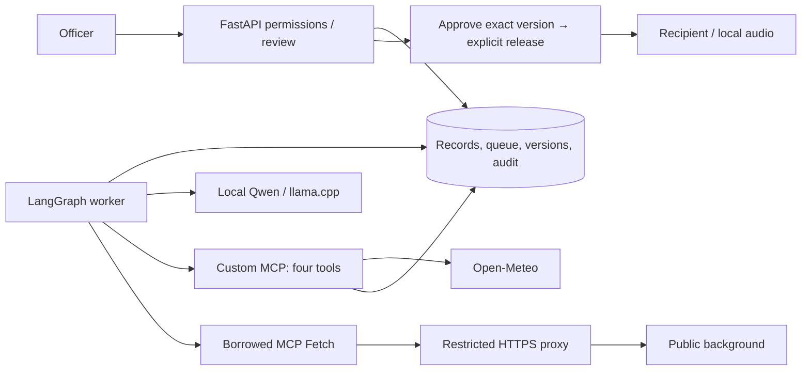

# Extension-office advisory architecture

**Theme:** climate-smart advisory for an Ethiopian extension office. Demonstration records and local guidance are synthetic; a participating office and field feedback remain unconfirmed.

**Agent.** A durable worker executes history → model plan → gather → per-plot draft/one repair → validated write → pending review. One to five plots have bounded contexts, saved candidates, retries, tool budgets and execution time. Database leases recover interruption; an atomic run/draft link prevents duplicate drafts. Local Qwen3-0.6B Q8 runs through checksum-pinned llama.cpp, without cloud fallback or tracing. The model chooses evidence priority and supplies structured candidates and citations. Unverified generated prose stays private because real tests exposed invented fieldwork claims.

**Built versus borrowed MCP.** Our run-scoped stdio server exposes `get_cluster_plot_history`, `get_weather_evidence`, `get_crop_risk_context` and `save_advisory_draft`. Calls recheck officer, office, hashed capability and lease. The independent pinned MCP Fetch server provides robots-aware document retrieval and Python HTML extraction, avoiding another fetching implementation. It receives only fixed public URLs, without household context. Its proxy checks domains/DNS, connects to validated public IPs and bounds traffic. Cached NRCS background is attributed; office guidance controls crop decisions.

**Defensibility.** Every recommendation cites matching history, weather, office guidance, calendar and public-background snapshots. Validation checks office/run, plot, crop, season, coordinates, dates, units and freshness. Planned crops require officer-entered rainfall-window, temperature and wind thresholds. Code independently checks planting/hold eligibility and renders numerical reasons; there are no universal agronomic defaults. Growing crops receive supported inspection actions. Conflicting pest reports require a visit; missing evidence blocks drafting. Unverified model narrative cannot become farmer-facing wording.

**Human gate.** Administrator-controlled memberships enforce scope. The agent has no approval, release, messaging, ordering or credit tools. Officers inspect, edit/reject, approve an immutable version, then separately release it. Edits require fresh approval; audit history and earlier releases remain. Farmers receive only their recipient snapshots; run logs stay private. Isolated local eSpeak NG synthesizes exactly the released text, reason and uncertainty, or an already-reviewed translation. Cloud speech is optional and explicit.

**Reproduction.** `python3 scripts/demo.py` installs locked dependencies, verifies model hashes, migrates/seeds SQLite, checks readiness and supervises all services. Persistent downloads, keys and databases are ignored. PostgreSQL, isolated-source startup, real model timings and compute-rate assumptions are documented in `EVALS.md`. Test host: i3-1315U, 12 GB RAM, CPU only. Host country, real agronomic effectiveness, public hosting and eligibility remain external checks. Original code is Apache-2.0; upstream terms remain applicable.
