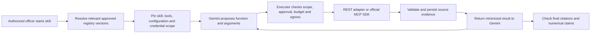

# Skills and integrations

A connection describes a reviewed destination and authentication method. A tool is one versioned operation on that connection. A skill contains instructions, required/optional capabilities and bounded investigation settings. A configuration pack groups these records for installation; it has no executable code. Installing the agriculture pack creates disabled templates, not working credentials or invented results.

For example, an officer asks a soil-explanation skill about a registered plot. The server loads the plot and household scope from existing workspace records. A server binding supplies its authorized coordinates; the model does not choose them. The registry resolves `soil.profile` to the office's tested and approved connection using role, capability and office priority. The iSDA adapter, when configured, logs in, reads the layer metadata and fetches available soil properties through the controlled transport. The validated estimates, depth, units, uncertainty and source limitations become evidence records. Gemini receives their limited payload and actual evidence IDs and explains what is known and missing. It is never asked to invent soil context from the account's chat history.

The new path has no vector database or automatic web search. PostgreSQL holds definitions, jobs and source evidence; the LangGraph checkpointer holds resumable conversation/tool state. Redis is an optional scoped cache. The existing Qwen advisory graph still uses its reviewed plot/season/guidance/evidence history and the existing four domain tools. The new companion's primary model is Gemini, with explicit local-model selection available and no automatic provider fallback.

The connector management sequence uses exact IDs/digests returned by the API:

1. `POST /api/v1/integrations` creates a disabled connection and performs no network request. For a custom REST connection specify `adapter_type`, a deployment-approved HTTPS `base_url`, authentication and permitted data classes.
2. If needed, `PUT /integrations/{id}/credential` writes a connection-owned credential over the protected transport. Only reference/revision metadata is returned. Credentials never belong in a skill, mapping, plugin or model chat.
3. `POST /integrations/{id}/tools` registers a REST operation with input schema, fixed request mapping, output projection/schema, capabilities and policy limits. For MCP, `POST /integrations/{id}/discover` uses the SDK and stages disabled candidates. Assign reviewed capabilities/descriptions by creating a new tool version.
4. `POST /integrations/{id}/tools/{tool_id}/preview` validates and shows the mapped request without contacting a provider. `.../test` requires exact `version`, `connection_revision`, `digest`, sample arguments, authorized plot IDs, a unique request key and `authorize_network: true`. External diagnostics also require `LIVE_TESTS_ENABLED=true`. Poll the returned `status_url`.
5. Inspect the actual outcome and evidence, then call `.../approve` for those same exact values. A test pass alone grants no permission. Separately enable the approved tool and connection with current `expected_revision` guards.
6. `POST /skills` registers instructions and capability tags. `.../test` validates configuration and capability resolution only; its result explicitly says no model request was made. Approve and enable that exact skill version.
7. `POST /skills/{id}/runs` queues a durable investigation. A cloud run needs `authorize_model: true` and `LIVE_MODEL_TESTS_ENABLED=true`; provider work needs `authorize_network: true`. Poll `/connector-jobs/{job_id}` or `/runs/{job_id}/results`; cancel with `/runs/{job_id}/cancel`.

The full paths have prefix `/api/v1`; request shapes and constraints are available from `/docs` and `/openapi.json`. `scripts/demo_connectors.py` is an executable registration/skill example. Test/preview fields are not tenant authority: identity comes from the verified membership.

Configure `GEMINI_API_KEY` and an explicit model ID in `GEMINI_MODEL` in the ignored backend environment. This release does not guess which model is available to your account. The official SDK receives function declarations; automatic function execution is disabled. Call IDs and opaque signatures survive checkpointing. Inputs, outputs, proposed aliases, follow-up rounds, output tokens and context size are bounded. Unknown functions and malformed arguments produce recorded outcomes. One empty-output repair is allowed, with both requests' usage recorded. Real model verification remains blocked until the key/model are supplied and the run is explicitly authorized.

New approval, enablement, credential or version changes bump a durable office generation. Every new run reads it before selecting a fresh snapshot, including across API/worker processes. Existing runs retain pinned versions, while emergency disables, changed discovered definitions, credential rotations and membership changes are rechecked before dispatch. Generic configuration requires no LangGraph source edit or application restart. Adding a new executable provider handler or unsupported protocol still requires a reviewed code deployment.

The agriculture pack is available at `/plugins/templates/agriculture-core`. Register with `POST /plugins`, install the exact returned digest with `POST /plugins/{id}/install`, and inspect the created resource IDs. Installation is atomic and idempotent. Enabling a pack permits child activation; each child still needs its own test, review and enablement. Disabling the pack disables its children. The reviewed Kindwise skill now uses an office-scoped private image asset and explicit credit-use authorization. See [verified API integration](VERIFIED_API_INTEGRATION.md) for the complete fourteen-provider pack and its separate activation results.

The companion produces an officer-facing evidence explanation. It does not approve, release, message a farmer, order inputs or submit external actions. Draft creation and delivery retain the existing human review workflow. Automated capability selection does not make providers scientifically interchangeable; forecast, historical climate, mapped soil, reported observations and fixtures retain distinct provenance.
